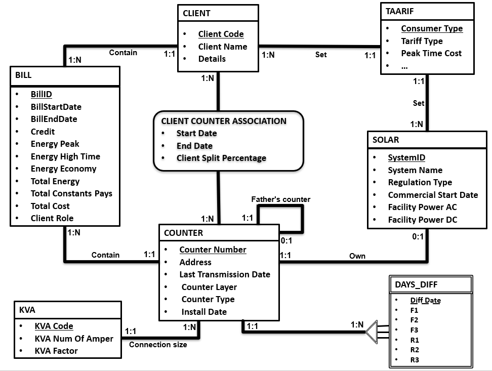
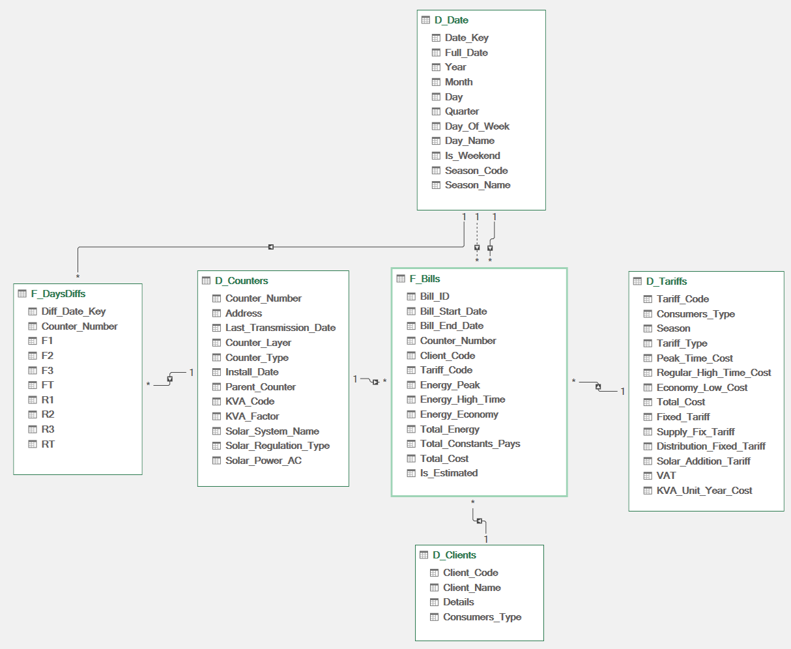
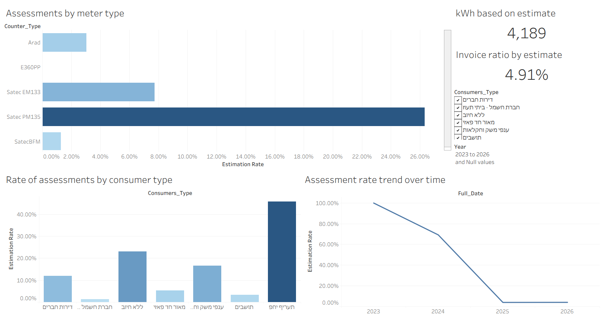
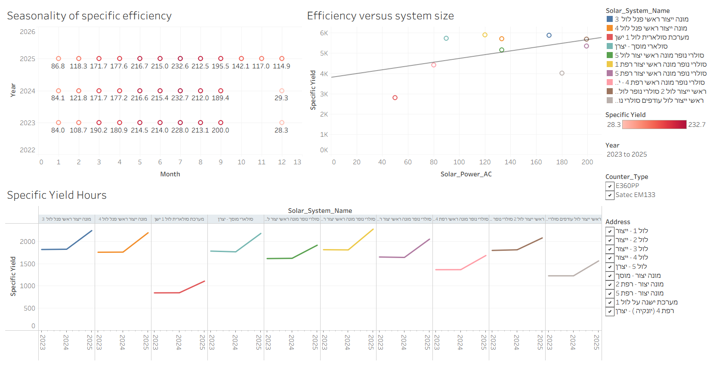
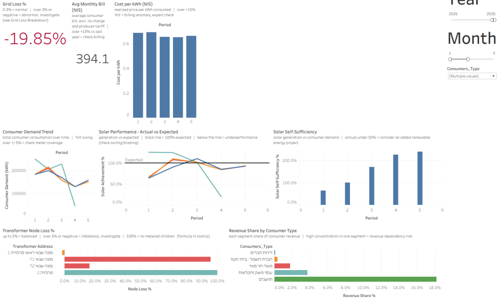
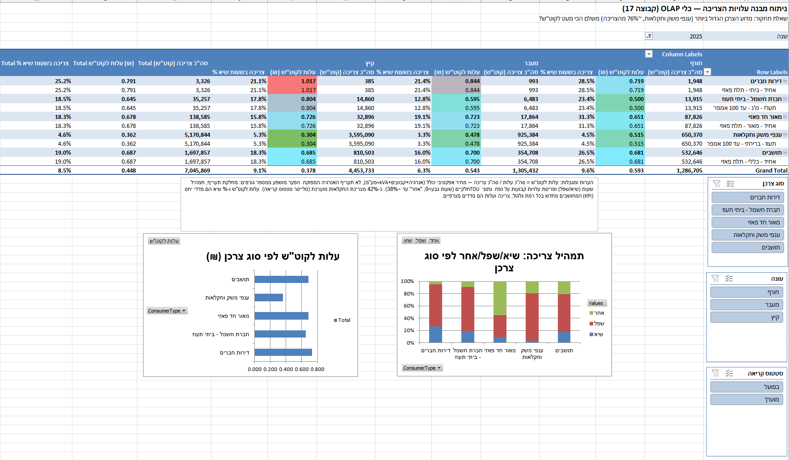
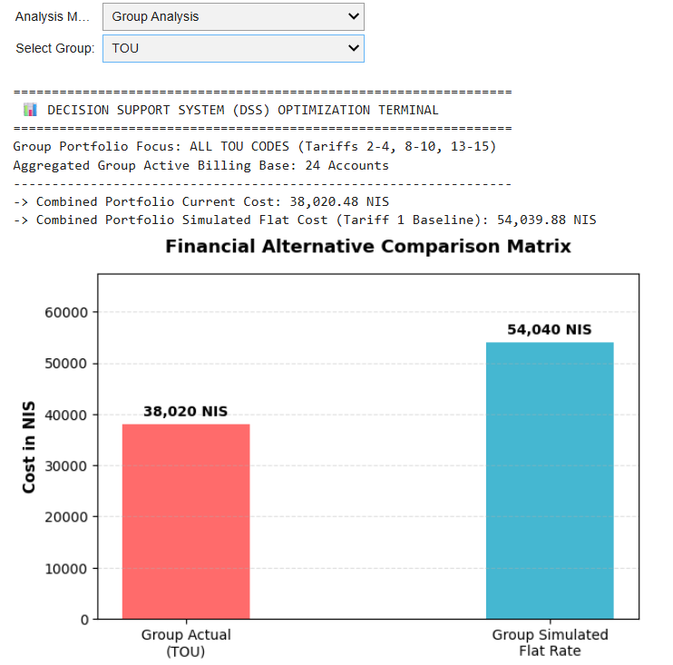
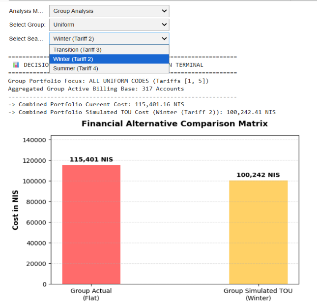

# Electricity Grid BI Analytics
## Business Intelligence on Real Utility Data

### Project Overview
A full BI project built on **real operational data** from the electricity department of a residential community: electricity meters, monthly bills, daily meter readings, tariffs and solar installations. We designed a data warehouse, built management reports and an executive dashboard, created an OLAP tool for cost analysis, and developed a decision-support model for tariff plans.

> The source data is confidential and is not included in this repository. The screenshots show aggregated results only.

### 1. Data Warehouse
* Moved from the operational ERD to a **star schema** with two fact tables at different granularity (monthly bills and daily meter readings) and four dimensions (date, clients, meters, tariffs).
* Applied slowly changing dimensions (SCD types 0, 1 and 2), surrogate keys, referential integrity with an "Unknown" member, and flattened small tables into the meter dimension to keep queries fast.
* Ratio KPIs are calculated in the BI layer, not stored in the fact tables, to avoid aggregation errors.

| Source ERD | Star schema |
|---|---|
|  |  |

### 2. Management Reports (Tableau)
* **Tactical, estimated bills:** Share of bills based on estimates instead of actual meter readings. The report pointed to one meter model and one consumer segment with unusually high estimation rates, which tells management where to send technicians.
* **Strategic, solar efficiency:** Specific yield of the solar installations over the years, efficiency versus system size and seasonality, to support future investment decisions.

### 3. Executive KPI Dashboard (Tableau)
Grid loss, average monthly bill, cost per kWh, demand trend, solar performance versus forecast, solar self-sufficiency, transformer node loss and revenue share by consumer type, with drill-down and filters.

### 4. OLAP Cost Analysis (Excel)
PivotTables, slicers, pivot charts and conditional formatting. The drill-down answered one question: why does the largest consumer segment (agriculture, about 76% of consumption) pay about half the price per kWh of residents? Because only about 4% of its consumption falls in expensive peak hours, compared with about 21% for residents.

### 5. Decision Support Model (Python)
An interactive pricing simulation with sensitivity analysis: compares time-of-use and flat tariff plans for a single client or a whole consumer group, and estimates savings from shifting consumption to off-peak hours.

| | |
|---|---|
|  |  |

### Tech Stack
Tableau, Excel (Power Pivot, PivotTables, Slicers), Python, data warehouse design (star schema, ETL, SCD)

*Course project ("Business Intelligence", grade 93/100), built as part of a team.*
